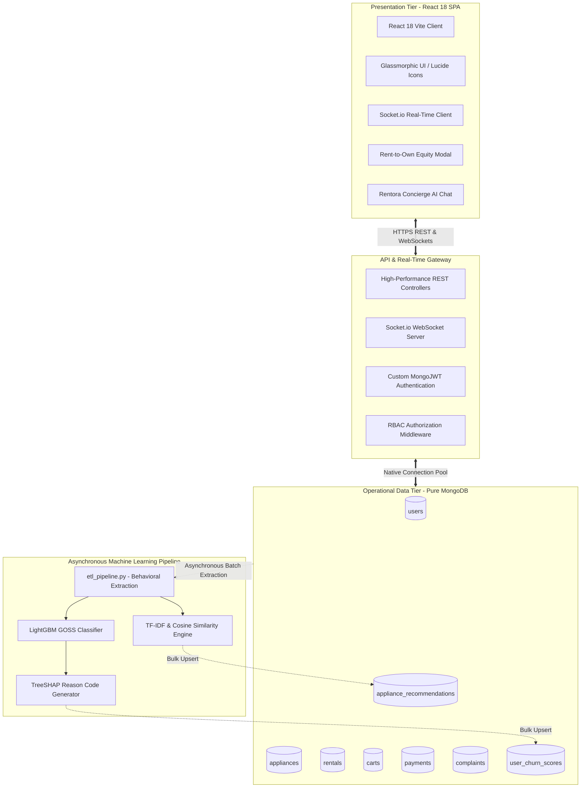

# SDC-II Project Architecture: Rentora System

This document formalizes the system architecture, component decomposition, and module breakdown for the **Rentora** platform, developed for the **SDC-II (Software Development Cell - II)** capstone curriculum. The architecture is cleanly divided into 15 distinct, highly cohesive development modules built on a **unified, high-performance MongoDB NoSQL architecture**, a **responsive React 18 Single Page Application (SPA)**, a **high-throughput RESTful API with real-time WebSockets**, and **asynchronous Machine Learning pipelines**.

---

## High-Level Architecture Overview

---

## 15-Module System Breakdown

### 1. User Authentication & Profile Management
* **Functionality**: Customer and admin registration, secure login sessions, and profile updates.
* **Security & Tokens**: Cryptographic PBKDF2 password hashing and custom stateless JWT access (60m) & refresh (7d) tokens.
* **Data Layer**: Interacts directly with the MongoDB `users` collection.

### 2. Multi-Role RBAC (Role-Based Access Control)
* **Functionality**: Strict authorization partitioning across 3 roles: `customer`, `owner` (peer lessor/vendor), and `admin`.
* **Portals**: Customer Home/Catalog, Peer Vendor Dashboard (`OwnerDashboard.jsx`), and System Admin Dashboard (`AdminDashboard.jsx`).

### 3. Appliance & Furniture Inventory Management
* **Functionality**: Master catalog management across 84+ appliances and furniture items with multi-city stock filtering (Bangalore, Mumbai, Delhi-NCR, Hyderabad, Pune).
* **Data Layer**: Stored in MongoDB `appliances` collection with rich, dynamic document schemas.

### 4. Dynamic Tenure Pricing Engine
* **Functionality**: Real-time calculation of tiered rental discounts across 3-month, 6-month, and 12-month commitments, security deposits, and taxes.

### 5. Mandatory KYC Verification Security Gateway
* **Functionality**: Mandatory upload of identity and address proofs before checkout. Unverified users receive HTTP 403 Forbidden to eliminate leasing fraud.

### 6. Rental Booking & Atomic Inventory Engine
* **Functionality**: Cart persistence and thread-safe checkout reservation.
* **Data Layer**: Executes atomic MongoDB `$inc: {"stock_quantity": -1}` operations and writes active leases to the `rentals` collection.

### 7. Rentora Shield (Accidental Damage Waiver)
* **Functionality**: Built-in ₹10,000 accidental damage protection waiver and 100% escrow security deposit refund protection.

### 8. Asset Return Processing & Refurbishment
* **Functionality**: Lease termination, damage level evaluation, deposit refund processing, and automated inventory restocking (`$inc: {"stock_quantity": 1}`).

### 9. Asynchronous ETL Machine Learning Pipeline
* **Functionality**: Python pipeline ([etl_pipeline.py](ml_pipeline/etl_pipeline.py)) compiling user behavioral engagement metrics from MongoDB collections without locking live transactional data.

### 10. Predictive Churn Classification Engine (LightGBM)
* **Functionality**: LightGBM GOSS classifier predicting churn risk probability with **95.33% Accuracy** and **99.10% ROC-AUC**.

### 11. Explainable AI (TreeSHAP Reason Code Generator)
* **Functionality**: Game-theoretic local feature attributions converted into actionable, human-readable retention reason codes.

### 12. Personalized Catalog Recommender
* **Functionality**: Sublinear TF-IDF vectorization and Cosine Similarity matrices delivering instant personalized Top-6 recommendations.

### 13. Rent-to-Own Equity Builder & Ownership Certificates
* **Functionality**: Accrues up to 70% of lease payments as equity towards asset buyout, complete with an interactive buyout calculator and tamper-evident printable ownership certificates.

### 14. UNLMTD Subscriptions & Curated Combos
* **Functionality**: Whole-home 1 BHK, 2 BHK, and 3 BHK packages with zero deposit, free annual style refreshes, and 1-click room bundles.

### 15. Real-Time Field Logistics Tracker & Rentora Concierge AI
* **Functionality**: Live Socket.io WebSocket field technician dispatch tracking across 5 fulfillment milestones, paired with a context-aware 24/7 AI chatbot assistant.

### 16. Serialized Inventory Asset Tracking & 4-Stage Refurbishment Workflow
* **Functionality**: Physical inventory tracking across individual serialized units (`serial_number`, `rfid_tag`, `depot_location`, `condition_grade`: Grade A+/A/B) with depreciation book value, rental ROI recovery, and a 4-stage reverse logistics refurbishment pipeline (`RETURN_INSPECTION` $\rightarrow$ `SANITIZATION_PART_REPLACE` $\rightarrow$ `QUALITY_AUDIT_28PT` $\rightarrow$ `RESTOCKED_AVAILABLE`).
* **Component**: [routes/inventory.js](server/src/routes/inventory.js).

### 17. Live Map-Based Real-Time GPS Logistics & Reverse Tracking
* **Functionality**: Interactive GPS route map rendering live moving technician/van coordinates, origin warehouse depot, customer delivery pin, dynamic speed/distance gauge, and live ETA countdown (~8 mins). Supports delivery fulfillment and return pickups.
* **Component**: [DeliveryTrackerModal.jsx](frontend/src/DeliveryTrackerModal.jsx), [routes/tracking.js](server/src/routes/tracking.js).

### 18. Comprehensive Executive Business Intelligence (BI) Suite
* **Functionality**: Financial SaaS KPIs (MRR, ARR run-rate, ARPU, Customer LTV, RBI-compliant security deposit escrow liability, 96.8% collection efficiency), 6-month seasonal category predictive demand forecasting, metro city profitability heatmaps (Bangalore, Mumbai, Delhi-NCR, Hyderabad, Pune), customer cohort retention decay matrices, and 1-click executive brief CSV/Excel export.
* **Component**: [BusinessIntelligenceTab.jsx](frontend/src/BusinessIntelligenceTab.jsx), [routes/admin.js](server/src/routes/admin.js).

### 19. Enterprise Razorpay Payment Gateway & Escrow Refund Pipeline
* **Functionality**: Full-lifecycle Razorpay payment gateway integration supporting Razorpay Standard Checkout popup, UPI, 3D-Secure Cards, NetBanking, and Doorstep COD. Features backend order generation (`/api/payments/create-order`), constant-time cryptographic HMAC-SHA256 signature verification (`/api/payments/verify-signature`), monthly subscription renewals, Razorpay webhook event processing with signature verification (`/api/payments/webhook`), automated security deposit refunds (`/api/payments/refund`), and dual-mode operation (Live credentials or enterprise sandbox simulator).
* **Component**: [razorpay.js](server/src/utils/razorpay.js), [payments.js](server/src/routes/payments.js), [PaymentGatewayModal.jsx](frontend/src/PaymentGatewayModal.jsx).

### 20. Customer Browsing History & Clickstream Recommendation Feed
* **Functionality**: Enterprise-grade product browsing history tracking across authenticated customers and guest sessions. Features zero-latency client-side caching in `localStorage`, persistent MongoDB `browsing_history` storage, deduplicated recency upsert with view counters, single-item removal, 1-click history clearing, relative time labeling ("Just now", "5m ago"), dynamic responsive horizontal carousel, and direct feedback loop into the AI Recommendation Engine for instant complementary room bundle personalizations.
* **Component**: [browsingHistory.js](server/src/routes/browsingHistory.js), [browsingHistory.js](frontend/src/utils/browsingHistory.js), [RecentlyViewedSection.jsx](frontend/src/RecentlyViewedSection.jsx).

